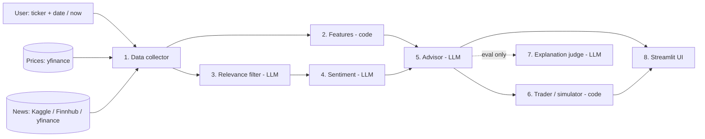

# Stock News Awareness Assistant

A Streamlit app that, for a chosen ticker and decision date, collects prices and news headlines, filters the relevant ones with an LLM, labels their sentiment, and returns an explained, calibrated suggestion (buy / hold / sell, 1 day / 1 week, confidence 0–100). A simulator trades on high-confidence advice. Every component is evaluated, and a look-ahead experiment checks whether the LLM "remembers the future" from its training data.

This is a course prototype. It is not financial advice.

- What we build: [docs/PROJECT_SPEC.md](docs/PROJECT_SPEC.md)
- How the coding agent works: [AGENTS.md](AGENTS.md), [CLAUDE.md](CLAUDE.md), skills in [.claude/skills/](.claude/skills/)
- Report: [docs/REPORT.md](docs/REPORT.md) · demo script: [docs/demo_script.md](docs/demo_script.md)
- CRISP-DM logs: [docs/crisp_dm/](docs/crisp_dm/)

## Setup
Requires Python 3.11 and [uv](https://docs.astral.sh/uv/) (plain `pip` also works).

```bash
uv venv --python 3.11 .venv
uv pip install --python .venv/bin/python -r requirements.txt
cp .env.example .env          # then fill in OPENROUTER_API_KEY and FINNHUB_API_KEY
```

1. **OpenRouter key** (free): https://openrouter.ai/keys. The model is `google/gemma-4-31b-it:free` (see `config.yaml`).
2. **Google AI Studio key** (free): create it at https://aistudio.google.com and add it in OpenRouter → Settings → Integrations (BYOK). Without it OpenRouter allows only 50 free requests a day. The key is stored by OpenRouter, not in this repo.
3. **Finnhub key** (free): https://finnhub.io/dashboard.
4. **Kaggle headlines**: download [Daily Financial News for 6000+ Stocks](https://www.kaggle.com/datasets/miguelaenlle/massive-stock-news-analysis-db-for-nlpbacktests) and put `raw_analyst_ratings.csv` and `raw_partner_headlines.csv` into `data/raw/kaggle_news/`.

## Run
```bash
source .venv/bin/activate

# 1. Data (once). Prices, PhraseBank, Finnhub news for the sampled decisions.
python -m src.data.download
python -m src.data.prepare          # sets A, B, C, outcomes, eval samples

# 2. Checks
ruff check .
pytest -q                           # the LLM is always mocked in tests

# 3. Evaluation. Slow the first time (free API), instant afterwards (disk cache).
python -m evals.run_all --smoke     # every eval on 20 items
python -m evals.run_all             # full run, refreshes the table below

# 4. The app
streamlit run app/streamlit_app.py
```

One eval can be run alone, for example `python -m evals.eval_sentiment --limit 20`.
Results go to `evals/results/<component>.json` and `<component>_errors.csv`.

## Architecture


| # | Component | Why it exists | Type | Code |
|---|---|---|---|---|
| 1 | Data collector | only the prices and news available at decision time | code + yfinance, Finnhub, local files | `src/data/collector.py` |
| 2 | Features | trend numbers; LLMs are bad at arithmetic | code | `src/data/features.py` |
| 3 | Relevance filter | drops headlines that are not about the company | LLM call 1 | `src/pipeline/relevance.py` |
| 4 | Sentiment labeler | good or bad for the stock | LLM call 2 (baseline: FinBERT) | `src/pipeline/sentiment.py` |
| 5 | Advisor | one explained, calibrated suggestion | LLM call 3 | `src/pipeline/advisor.py` |
| 6 | Trader | measures whether confident advice makes money | code | `src/sim/simulator.py` |
| 7 | Explanation judge | checks that explanations do not invent facts | LLM call 4, eval only | `src/pipeline/judge.py` |
| 8 | UI | chart, headlines, advice, trace, simulator, evals | Streamlit | `app/streamlit_app.py` |

All LLM calls go through `src/llm/client.py`: disk cache, retries, rate limit, JSON validation, trace log in `logs/llm_calls.jsonl`.

## Business rules
- **No look-ahead.** A decision at the close of day t uses prices up to t and headlines of [t − 3 days, t]. A headline published after the close, or without a time, belongs to the next trading day.
- **The advisor** may use only what is in its prompt and must list the ids of the headlines it relied on.
- **No relevant news** → advice from price features only, flagged `news_used = false`.
- **The LLM never calculates.** Returns and volatility are computed in Python and passed in.
- **Live mode:** one advice per ticker per day, plus a new one when a new relevant headline appears.
- **Simulator:** starts with $10,000; long only; buys when `action = buy` and `confidence ≥ 70`, with 20% of equity; holds for the advised horizon or sells earlier when a later advice says `sell`; fee 0.1% per trade; one position per ticker; trades at the close of the decision day.
- **Sets for the look-ahead experiment:** A = 2019 with real names; B = the same rows anonymized; C = Nov 2025 – Nov 2026, after the model's knowledge cutoff (Jan 2025); D = live advice.

## Repository layout
```
app/            Streamlit UI (no business logic)
src/data/       download, clean, align, features, collector (no LLM calls)
src/llm/        client.py: the only place that calls an LLM
src/pipeline/   relevance, sentiment, advisor, judge, orchestrator, live rule, batch runs
src/sim/        simulator (pure Python)
prompts/        prompt templates with versions
evals/          eval_<component>.py, labels/, results/
tests/          pytest, LLM mocked
docs/           spec, CRISP-DM logs, report, demo script
config.yaml     tickers, dates, model, thresholds, seed
```

## Results
Generated by `python -m evals.run_all` from `evals/results/*.json`. Do not edit by hand.
Metric names start with the set letter where it applies (A, B, C, D). Analysis: [docs/crisp_dm/05_evaluation.md](docs/crisp_dm/05_evaluation.md).

<!-- EVALS:START -->
| Component | Metric | Value | 95% CI | Baseline | n | Prompt | Model |
|---|---|---|---|---|---|---|---|
| data | missing_trading_days_rate | 0.000 | [0.000, 0.000] |  | 17840 |  |  |
| data | duplicate_headlines_rate_raw | 0.044 | [0.041, 0.046] |  | 24967 |  |  |
| data | duplicate_headlines_rate_in_sets | 0.000 | [0.000, 0.000] |  | 7478 |  |  |
| data | lookahead_violation_rate | 0.000 | [0.000, 0.000] |  | 7478 |  |  |
| data | set_b_leak_rate | 0.000 | [0.000, 0.000] |  | 3013 |  |  |
| data | missing_outcome_rate | 0.000 | [0.000, 0.000] |  | 600 |  |  |
| features | exact_match_rate | 1.000 | [1.000, 1.000] |  | 15 |  |  |
| features | max_abs_error | 0.000 |  |  | 15 |  |  |
| llm_client | valid_json_first_answer_rate | 0.998 | [0.996, 1.000] |  | 1691 |  |  |
| llm_client | invalid_after_retry_rate | 0.001 | [0.000, 0.002] |  | 1695 |  |  |
| llm_client | transport_error_rate | 0.002 | [0.001, 0.005] |  | 1695 |  |  |
| llm_client | mean_latency_s | 140.548 | [134.483, 146.913] |  | 1695 |  |  |
| llm_client | mean_http_attempts_per_call | 4.218 | [4.018, 4.418] |  | 1695 |  |  |
| llm_client | cache_hit_rate | 0.465 | [0.447, 0.482] |  | 3166 |  |  |
| relevance | precision | 0.951 | [0.872, 1.000] | keep_all 0.390; keyword 0.848 | 100 | relevance_v1 | google/gemma-4-31b-it:free |
| relevance | recall | 1.000 | [1.000, 1.000] | keep_all 1.000; keyword 1.000 | 100 | relevance_v1 | google/gemma-4-31b-it:free |
| relevance | f1 | 0.975 | [0.931, 1.000] | keep_all 0.561; keyword 0.918 | 100 | relevance_v1 | google/gemma-4-31b-it:free |
| sentiment | phrasebank.accuracy | 0.892 | [0.863, 0.920] | finbert 0.940; always_neutral 0.610 | 400 | sentiment_v1 | google/gemma-4-31b-it:free |
| sentiment | phrasebank.macro_f1 | 0.899 | [0.865, 0.927] | finbert 0.927; always_neutral 0.253 | 400 | sentiment_v1 | google/gemma-4-31b-it:free |
| sentiment | fresh.accuracy | 0.910 | [0.850, 0.960] | finbert 0.460; always_neutral 0.740 | 100 | sentiment_v1 | google/gemma-4-31b-it:free |
| sentiment | fresh.macro_f1 | 0.898 | [0.810, 0.960] | finbert 0.333; always_neutral 0.283 | 100 | sentiment_v1 | google/gemma-4-31b-it:free |
| sentiment | fresh_relevant.accuracy | 0.923 | [0.846, 1.000] | finbert 0.385; always_neutral 0.333 | 39 | sentiment_v1 | google/gemma-4-31b-it:free |
| sentiment | fresh_relevant.macro_f1 | 0.931 | [0.847, 1.000] | finbert 0.386; always_neutral 0.167 | 39 | sentiment_v1 | google/gemma-4-31b-it:free |
| advisor | A.hit_rate | 0.496 | [0.405, 0.580] | always_buy 0.664; same_as_last_move 0.420 | 131 | advisor_v1 | google/gemma-4-31b-it:free |
| advisor | A.directional_share | 0.655 |  |  | 200 | advisor_v1 | google/gemma-4-31b-it:free |
| advisor | A.mean_return_chosen_horizon_pct | -0.030 | [-1.011, 0.912] | fixed_1d -0.045; fixed_1w -0.049 | 131 | advisor_v1 | google/gemma-4-31b-it:free |
| advisor | A.hit_rate_confidence_50_60 | 0.222 | [0.000, 0.556] |  | 9 | advisor_v1 | google/gemma-4-31b-it:free |
| advisor | A.hit_rate_confidence_60_80 | 0.513 | [0.419, 0.607] |  | 117 | advisor_v1 | google/gemma-4-31b-it:free |
| advisor | A.hit_rate_confidence_80_100 | 0.600 | [0.200, 1.000] |  | 5 | advisor_v1 | google/gemma-4-31b-it:free |
| advisor | B.hit_rate | 0.481 | [0.397, 0.565] | always_buy 0.672; same_as_last_move 0.427 | 131 | advisor_v1 | google/gemma-4-31b-it:free |
| advisor | B.directional_share | 0.655 |  |  | 200 | advisor_v1 | google/gemma-4-31b-it:free |
| advisor | B.mean_return_chosen_horizon_pct | -0.079 | [-1.008, 0.886] | fixed_1d -0.103; fixed_1w -0.098 | 131 | advisor_v1 | google/gemma-4-31b-it:free |
| advisor | B.hit_rate_confidence_50_60 | 0.167 | [0.000, 0.500] |  | 6 | advisor_v1 | google/gemma-4-31b-it:free |
| advisor | B.hit_rate_confidence_60_80 | 0.492 | [0.410, 0.582] |  | 122 | advisor_v1 | google/gemma-4-31b-it:free |
| advisor | B.hit_rate_confidence_80_100 | 0.667 | [0.000, 1.000] |  | 3 | advisor_v1 | google/gemma-4-31b-it:free |
| advisor | C.hit_rate | 0.531 | [0.438, 0.615] | always_buy 0.454; same_as_last_move 0.523 | 130 | advisor_v1 | google/gemma-4-31b-it:free |
| advisor | C.directional_share | 0.653 |  |  | 199 | advisor_v1 | google/gemma-4-31b-it:free |
| advisor | C.mean_return_chosen_horizon_pct | 0.504 | [-0.569, 1.686] | fixed_1d 0.112; fixed_1w 0.469 | 130 | advisor_v1 | google/gemma-4-31b-it:free |
| advisor | C.hit_rate_confidence_50_60 | 0.400 | [0.000, 0.800] |  | 5 | advisor_v1 | google/gemma-4-31b-it:free |
| advisor | C.hit_rate_confidence_60_80 | 0.526 | [0.431, 0.621] |  | 116 | advisor_v1 | google/gemma-4-31b-it:free |
| advisor | C.hit_rate_confidence_80_100 | 0.667 | [0.333, 0.889] |  | 9 | advisor_v1 | google/gemma-4-31b-it:free |
| judge | claims_supported_rate | 0.998 | [0.994, 1.000] |  | 100 | judge_v1 | google/gemma-4-31b-it:free |
| judge | judge_label_agreement | 0.991 | [0.972, 1.000] | always_supported 0.991 | 109 | judge_v1 | google/gemma-4-31b-it:free |
| judge | planted_false_claims_caught_rate | 1.000 | [1.000, 1.000] | always_supported 0.000 | 20 | judge_v1 | google/gemma-4-31b-it:free |
| simulator | A.total_return | -0.026 | [-0.106, 0.058] | buy_and_hold 0.388 | 255 |  |  |
| simulator | A.sharpe | -0.570 | [-2.428, 1.378] | buy_and_hold 1.711 | 255 |  |  |
| simulator | A.max_drawdown | 0.071 | [0.020, 0.123] | buy_and_hold 0.186 | 255 |  |  |
| simulator | A.win_rate | 0.429 | [0.238, 0.667] |  | 21 |  |  |
| simulator | A.n_trades | 21 |  |  | 21 |  |  |
| simulator | B.total_return | 0.010 | [-0.063, 0.091] | buy_and_hold 0.388 | 255 |  |  |
| simulator | B.sharpe | 0.263 | [-1.762, 2.085] | buy_and_hold 1.711 | 255 |  |  |
| simulator | B.max_drawdown | 0.039 | [0.013, 0.083] | buy_and_hold 0.186 | 255 |  |  |
| simulator | B.win_rate | 0.474 | [0.263, 0.684] |  | 19 |  |  |
| simulator | B.n_trades | 19 |  |  | 19 |  |  |
| simulator | C.total_return | 0.025 | [-0.094, 0.169] | buy_and_hold 0.008 | 241 |  |  |
| simulator | C.sharpe | 0.426 | [-1.561, 2.445] | buy_and_hold 0.186 | 241 |  |  |
| simulator | C.max_drawdown | 0.064 | [0.019, 0.125] | buy_and_hold 0.292 | 241 |  |  |
| simulator | C.win_rate | 0.565 | [0.348, 0.783] |  | 23 |  |  |
| simulator | C.n_trades | 23 |  |  | 23 |  |  |
| lookahead | A.hit_rate | 0.496 | [0.405, 0.580] | always_buy 0.664 | 131 | memory_probe_v1 | google/gemma-4-31b-it:free |
| lookahead | B.hit_rate | 0.481 | [0.397, 0.565] | always_buy 0.672 | 131 | memory_probe_v1 | google/gemma-4-31b-it:free |
| lookahead | C.hit_rate | 0.531 | [0.438, 0.615] | always_buy 0.454 | 130 | memory_probe_v1 | google/gemma-4-31b-it:free |
| lookahead | A_minus_B.hit_rate_paired | 0.000 | [0.000, 0.000] |  | 124 | memory_probe_v1 | google/gemma-4-31b-it:free |
| lookahead | D.hit_rate | n/a |  |  | 0 | memory_probe_v1 | google/gemma-4-31b-it:free |
| lookahead | memory_probe.2019.within_5pct | 0.360 | [0.240, 0.500] |  | 50 | memory_probe_v1 | google/gemma-4-31b-it:free |
| lookahead | memory_probe.post_cutoff.within_5pct | 0.000 | [0.000, 0.000] |  | 50 | memory_probe_v1 | google/gemma-4-31b-it:free |
| lookahead | sentiment_gap.accuracy_phrasebank_minus_fresh | -0.018 | [-0.082, 0.045] |  | 100 | memory_probe_v1 | google/gemma-4-31b-it:free |
| ui | checks_passed_rate | 1.000 | [1.000, 1.000] |  | 21 |  |  |
| ui | demo_cases_passed_rate | 1.000 | [1.000, 1.000] |  | 3 |  |  |
<!-- EVALS:END -->
