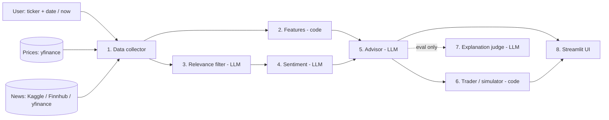

# Stock News Awareness Assistant

A Streamlit app that, for a chosen ticker and decision date, collects prices and news headlines, filters the relevant ones with an LLM, labels their sentiment, and returns an explained, calibrated suggestion (buy / hold / sell, 1 day / 1 week, confidence 0–100). A simulator trades on high-confidence advice, every component is evaluated, and a look-ahead experiment checks whether the LLM "remembers the future".

Specification: [docs/PROJECT_SPEC.md](docs/PROJECT_SPEC.md) · Agent rules: [AGENTS.md](AGENTS.md) · CRISP-DM logs: [docs/crisp_dm/](docs/crisp_dm/)

## Setup
Requires Python 3.11 and [uv](https://docs.astral.sh/uv/) (or plain `pip`).

```bash
uv venv --python 3.11 .venv
uv pip install --python .venv/bin/python -r requirements.txt
cp .env.example .env          # then fill in OPENROUTER_API_KEY and FINNHUB_API_KEY
```

- **LLM:** `google/gemma-4-31b-it` through OpenRouter (see `config.yaml`). To avoid the shared free-tier limits, add a free Google AI Studio key in OpenRouter → Settings → Integrations (BYOK). The code only needs `OPENROUTER_API_KEY`.
- **Historical news:** download the Kaggle dataset [Daily Financial News for 6000+ Stocks](https://www.kaggle.com/datasets/miguelaenlle/massive-stock-news-analysis-db-for-nlpbacktests) and put `raw_analyst_ratings.csv` and `raw_partner_headlines.csv` into `data/raw/kaggle_news/`.

## Run
_Commands are added as each CRISP-DM phase is completed._

```bash
.venv/bin/ruff check .
.venv/bin/pytest -q
```

## Architecture


## Business rules
See [docs/PROJECT_SPEC.md §6](docs/PROJECT_SPEC.md). Simulator parameters live in `config.yaml` → `simulator`.

## Results
Generated by the `run-evals` skill from `evals/results/*.json`. Do not edit by hand.

<!-- EVALS:START -->
<!-- EVALS:END -->
