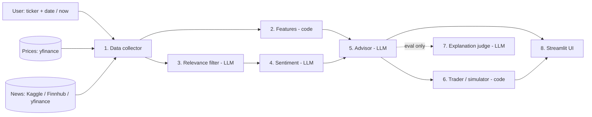

# Stock News Awareness Assistant

A Streamlit app that, for a chosen ticker and decision date, collects prices and news headlines, filters the relevant ones with an LLM, labels their sentiment, and returns an explained, calibrated suggestion (buy / hold / sell, 1 day / 1 week, confidence 0–100). A simulator trades on high-confidence advice. Every component is evaluated, and a look-ahead experiment checks whether the LLM "remembers the future" from its training data.

This is a course prototype. It is not financial advice.

- What we build: [docs/PROJECT_SPEC.md](docs/PROJECT_SPEC.md)
- How the coding agent works: [AGENTS.md](AGENTS.md), [CLAUDE.md](CLAUDE.md), skills in [.claude/skills/](.claude/skills/)
- Report: [docs/REPORT.md](docs/REPORT.md) · demo script: [docs/demo_script.md](docs/demo_script.md)
- CRISP-DM logs: [docs/crisp_dm/](docs/crisp_dm/)

## Setup
Requires Python 3.11 and [uv](https://docs.astral.sh/uv/) (plain `pip` also works).

```bash
uv venv --python 3.11 .venv
uv pip install --python .venv/bin/python -r requirements.txt
cp .env.example .env          # then fill in OPENROUTER_API_KEY and FINNHUB_API_KEY
```

1. **OpenRouter key** (free): https://openrouter.ai/keys. The model is `google/gemma-4-31b-it:free` (see `config.yaml`).
2. **Google AI Studio key** (free): create it at https://aistudio.google.com and add it in OpenRouter → Settings → Integrations (BYOK). Without it OpenRouter allows only 50 free requests a day. The key is stored by OpenRouter, not in this repo.
3. **Finnhub key** (free): https://finnhub.io/dashboard.
4. **Kaggle headlines**: download [Daily Financial News for 6000+ Stocks](https://www.kaggle.com/datasets/miguelaenlle/massive-stock-news-analysis-db-for-nlpbacktests) and put `raw_analyst_ratings.csv` and `raw_partner_headlines.csv` into `data/raw/kaggle_news/`.

## Run
```bash
source .venv/bin/activate

# 1. Data (once). Prices, PhraseBank, Finnhub news for the sampled decisions.
python -m src.data.download
python -m src.data.prepare          # sets A, B, C, outcomes, eval samples

# 2. Checks
ruff check .
pytest -q                           # the LLM is always mocked in tests

# 3. Evaluation. Slow the first time (free API), instant afterwards (disk cache).
python -m evals.run_all --smoke     # every eval on 20 items
python -m evals.run_all             # full run, refreshes the table below

# 4. The app
streamlit run app/streamlit_app.py
```

One eval can be run alone, for example `python -m evals.eval_sentiment --limit 20`.
Results go to `evals/results/<component>.json` and `<component>_errors.csv`.

## Architecture


| # | Component | Why it exists | Type | Code |
|---|---|---|---|---|
| 1 | Data collector | only the prices and news available at decision time | code + yfinance, Finnhub, local files | `src/data/collector.py` |
| 2 | Features | trend numbers; LLMs are bad at arithmetic | code | `src/data/features.py` |
| 3 | Relevance filter | drops headlines that are not about the company | LLM call 1 | `src/pipeline/relevance.py` |
| 4 | Sentiment labeler | good or bad for the stock | LLM call 2 (baseline: FinBERT) | `src/pipeline/sentiment.py` |
| 5 | Advisor | one explained, calibrated suggestion | LLM call 3 | `src/pipeline/advisor.py` |
| 6 | Trader | measures whether confident advice makes money | code | `src/sim/simulator.py` |
| 7 | Explanation judge | checks that explanations do not invent facts | LLM call 4, eval only | `src/pipeline/judge.py` |
| 8 | UI | chart, headlines, advice, trace, simulator, evals | Streamlit | `app/streamlit_app.py` |

All LLM calls go through `src/llm/client.py`: disk cache, retries, rate limit, JSON validation, trace log in `logs/llm_calls.jsonl`.

## Business rules
- **No look-ahead.** A decision at the close of day t uses prices up to t and headlines of [t − 3 days, t]. A headline published after the close, or without a time, belongs to the next trading day.
- **The advisor** may use only what is in its prompt and must list the ids of the headlines it relied on.
- **No relevant news** → advice from price features only, flagged `news_used = false`.
- **The LLM never calculates.** Returns and volatility are computed in Python and passed in.
- **Live mode:** one advice per ticker per day, plus a new one when a new relevant headline appears.
- **Simulator:** starts with $10,000; long only; buys when `action = buy` and `confidence ≥ 70`, with 20% of equity; holds for the advised horizon or sells earlier when a later advice says `sell`; fee 0.1% per trade; one position per ticker; trades at the close of the decision day.
- **Sets for the look-ahead experiment:** A = 2019 with real names; B = the same rows anonymized; C = Nov 2025 – Nov 2026, after the model's knowledge cutoff (Jan 2025); D = live advice.

## Repository layout
```
app/            Streamlit UI (no business logic)
src/data/       download, clean, align, features, collector (no LLM calls)
src/llm/        client.py: the only place that calls an LLM
src/pipeline/   relevance, sentiment, advisor, judge, orchestrator, live rule, batch runs
src/sim/        simulator (pure Python)
prompts/        prompt templates with versions
evals/          eval_<component>.py, labels/, results/
tests/          pytest, LLM mocked
docs/           spec, CRISP-DM logs, report, demo script
config.yaml     tickers, dates, model, thresholds, seed
```

## Results
Generated by `python -m evals.run_all` from `evals/results/*.json`. Do not edit by hand.
Metric names start with the set letter where it applies (A, B, C, D). Analysis: [docs/crisp_dm/05_evaluation.md](docs/crisp_dm/05_evaluation.md).

<!-- EVALS:START -->
| Component | Metric | Value | 95% CI | Baseline | n | Prompt | Model |
|---|---|---|---|---|---|---|---|
| data | missing_trading_days_rate | 0.000 | [0.000, 0.000] |  | 17840 |  |  |
| data | duplicate_headlines_rate_raw | 0.044 | [0.041, 0.046] |  | 24967 |  |  |
| data | duplicate_headlines_rate_in_sets | 0.000 | [0.000, 0.000] |  | 7478 |  |  |
| data | lookahead_violation_rate | 0.000 | [0.000, 0.000] |  | 7478 |  |  |
| data | set_b_leak_rate | 0.000 | [0.000, 0.000] |  | 3013 |  |  |
| data | missing_outcome_rate | 0.000 | [0.000, 0.000] |  | 600 |  |  |
| features | exact_match_rate | 1.000 | [1.000, 1.000] |  | 15 |  |  |
| features | max_abs_error | 0.000 |  |  | 15 |  |  |
| relevance | precision | 0.951 | [0.872, 1.000] | keep_all 0.390; keyword 0.848 | 100 | relevance_v1 | google/gemma-4-31b-it:free |
| relevance | recall | 1.000 | [1.000, 1.000] | keep_all 1.000; keyword 1.000 | 100 | relevance_v1 | google/gemma-4-31b-it:free |
| relevance | f1 | 0.975 | [0.931, 1.000] | keep_all 0.561; keyword 0.918 | 100 | relevance_v1 | google/gemma-4-31b-it:free |
<!-- EVALS:END -->
