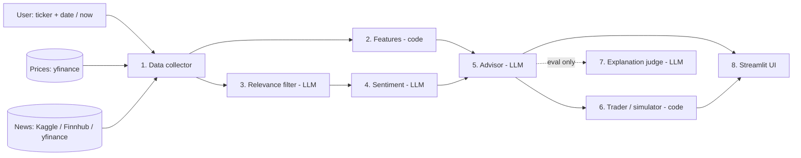

# Project Spec — Stock News Awareness Assistant

## 1. Goal
Help a retail investor follow a company: see the price trend, the relevant news with sentiment, and an explained, calibrated suggestion. Then measure honestly whether the suggestions are any good, including whether the LLM "peeks" into a future it memorized during training.

## 2. User flow
Input: ticker (e.g. `NVDA`) + decision date (historical mode) or "now" (live mode).
Output:
- price chart;
- relevant headlines, each with a sentiment label;
- advice: action, horizon, confidence, explanation;
- simulator results (separate tab).

## 3. Scope
**In:**
- 8 US large caps: GOOGL, NVDA, TSLA, JPM, INTC, NFLX, AVGO, HD; BTC-USD optional.
  (Changed 2026-11-14 by the human: AAPL, MSFT, AMZN, META have 0 headlines for 2019 in the Kaggle dataset, so they were replaced by large caps with 2019 coverage. See `docs/crisp_dm/01_business.md`.)
- Headlines only, daily prices, horizons of 1 day and 1 week.
- Historical mode and live mode, Streamlit UI.

**Out:** real trading, intraday trading, short selling, portfolio optimization, full-text articles, fine-tuning.

## 4. Data
| Dataset | Source | Use |
|---|---|---|
| Daily prices | `yfinance` (Yahoo Finance), 2018-01-01 → today | features, ground truth for advice, simulator |
| Historical headlines | Kaggle `miguelaenlle/massive-stock-news-analysis-db-for-nlpbacktests` ("Daily Financial News for 6000+ Stocks", ~4M Benzinga headlines, 2009–2020). The human downloads the CSV into `data/raw/` manually. | sets A and B (year 2019) |
| Fresh headlines | Finnhub `company-news` API (free key, ~1 year of history) | set C (after the model's training cutoff) and live mode |
| Live headlines (backup) | `yfinance` `Ticker.news` | live mode |
| Sentiment exam | Hugging Face `takala/financial_phrasebank`, config `sentences_75agree` (labels: negative / neutral / positive) | sentiment eval, sample n = 400, seed 42 |
| Human labels | `evals/labels/fresh_headlines.csv`: 100 fresh headlines labeled by the human: `relevant` (y/n) + `sentiment` | relevance eval + fresh sentiment eval |

**Existing datasets checked before choosing (no synthetic data needed):**
- FNSPID (news + prices, S&P 500, 1999–2023): rejected, too heavy (~30 GB, the HF viewer fails).
- NIFTY (daily SPY headlines + movement labels): market-level only, not per company → optional extension.
- EDT (corporate event detection + trading benchmark): optional extension for event types.
- DLT-Sentiment-News (crypto news with crowd sentiment labels): optional, if BTC-USD is added.

## 4b. Model
- One free OpenRouter model, chosen from https://openrouter.ai/collections/free-models and stored in `config.yaml` as `model_id`, `model_release_date` and `knowledge_cutoff` (if published).
- If the knowledge cutoff is not published, use the release date as the safe boundary: the model cannot have seen news published after its release.
- The model is frozen once phase 5 starts. All evals use the same `model_id`.

## 5. Components
Rule: the LLM is used only for language tasks (judging text). Everything numeric is plain code.

| # | Component | Purpose (why it exists) | Type / calls | Input | Output |
|---|---|---|---|---|---|
| 1 | Data collector | get only the prices and news available at time t | code + **external APIs**: yfinance, Finnhub (live), local files (historical) | ticker, date t | prices up to t; headlines in [t − 3 days, t] |
| 2 | Features | turn the price series into a few trend numbers (LLMs are bad at arithmetic) | code | prices | ret_1d, ret_5d, ret_20d, volatility_20d |
| 3 | Relevance filter | drop headlines that only mention the company in passing (noise) | **LLM call #1** | company name + headlines | per headline: relevant (bool) + reason |
| 4 | Sentiment labeler | say whether each headline is good or bad for the stock | **LLM call #2**; baseline FinBERT `ProsusAI/finbert` (local model) | headline | label (pos / neg / neu) + reason |
| 5 | Advisor | combine trend + news into one explained, calibrated suggestion | **LLM call #3** | features + labeled headlines | action, horizon (1d / 1w), confidence (0–100), explanation, ids of headlines used |
| 6 | Trader (simulator) | "buys" when the advisor is highly confident, to measure whether the advice makes money | code | stream of advice + prices | trades, equity curve, metrics |
| 7 | Explanation judge | check that the explanation does not invent facts | **LLM call #4** (eval only) | explanation + the advisor's inputs | per claim: supported / unsupported |
| 8 | UI | show everything and let the user refresh live | Streamlit | user input | chart, news table, advice card, refresh button, trace panel (LLM calls of this request), simulator tab, evals tab |

Infrastructure: `src/llm/client.py` (one wrapper for all LLM calls: cache, retries, JSON validation, trace log).

## 5b. Walkthrough of one input (illustrative values)
Input: `NVDA`, `2019-05-15`, historical mode.
1. **Collector:** loads NVDA prices up to 2019-05-15 and 8 headlines dated 2019-05-12 … 2019-05-15. A headline published after 16:00 ET on 05-15 is moved to 05-16, so it is not used.
2. **Features:** ret_1d −0.4%, ret_5d −3.1%, ret_20d +5.2%, volatility medium.
3. **Relevance (LLM #1):** keeps 4 headlines. 4 are general market wrap-ups.
4. **Sentiment (LLM #2):** 3 positive (e.g. "record data-center revenue"), 1 negative.
5. **Advisor (LLM #3):** `{"action": "buy", "horizon": "1w", "confidence": 65, "explanation": "...", "used_headlines": [1, 2, 4]}`.
6. **Trader:** confidence 65 < 70 → no trade.
7. **Judge (evaluation only):** 3 of 3 claims are supported by the inputs.
8. **UI:** chart + colored headlines + advice card + trace of the 3 LLM calls.
9. **Ground truth for evals:** NVDA's actual 1-week return after 2019-05-15 decides whether the advice was a hit.

## 6. Business rules
- The advisor may only use the inputs given in its prompt and must list the ids of the headlines it relied on.
- No relevant news → advice from price features only, flagged `news_used = false`.
- Live mode: one advice per ticker per day, plus an extra advice whenever a new relevant headline appears.
- Simulator:
  - starts with $10,000; long only;
  - buys only if `action = buy` and `confidence ≥ 70`, with 20% of equity per trade;
  - holds for the chosen horizon, or sells earlier if a later advice for that ticker says `sell`;
  - fee 0.1% per trade.

## 7. Metrics (per component)
| Component | Eval data | Metric | Why this metric | Baseline |
|---|---|---|---|---|
| Data collector | all downloaded data | % missing trading days, % duplicate headlines, no-look-ahead test passes | bad or leaked data silently ruins every later metric | — |
| Features | 3 tickers × 5 dates, computed by hand | exact match (tolerance 1e-6) | deterministic code → correctness, not accuracy | — |
| LLM client | all eval runs | % valid JSON, % errors after retry, mean latency, cache hit rate | broken outputs would be counted as model mistakes | — |
| Relevance filter | 100 human-labeled fresh headlines | precision, recall, F1 | precision = noise let through; recall = useful news lost | keep all headlines |
| Sentiment labeler | PhraseBank sample (400) + 100 human-labeled fresh headlines | accuracy, macro-F1, confusion matrix | classes are imbalanced (many neutral) → macro-F1, not only accuracy | FinBERT; "always neutral" |
| Advisor: direction | sets A–C (n ≈ 300 per set) | hit rate: the price moved in the advised direction over the chosen horizon | directly answers "is the advice right?" | "always buy" (stocks rise more often than they fall); "same as last move" |
| Advisor: horizon choice | same | return using the LLM-chosen horizon vs fixed 1d and fixed 1w | shows whether choosing the horizon adds value | fixed horizons |
| Advisor: confidence | same | hit rate per confidence bucket (50–60 / 60–80 / 80–100) | the trader relies on confidence, so it must mean something (calibration) | hit rate should rise with confidence |
| Explanation | 100 explanations | % claims supported by the inputs (judge); judge vs human agreement on 20 | catches hallucinated reasons; the agreement shows the judge can be trusted | — |
| Trader (simulator) | 2019 (A, B) and fresh period (C) | total return, Sharpe, max drawdown, number of trades, % winning trades | return alone hides risk; Sharpe and drawdown show it | buy & hold of the same tickers |
| UI | 3 demo cases | checklist: app starts, every tab renders, the numbers shown equal the pipeline output | the demo must show exactly what was evaluated | — |

Every metric is reported with n and a 95% bootstrap confidence interval.

## 8. Look-ahead (memorization) experiment
Run the advisor and the simulator on three sets with the same metrics:

| Set | Data | Can the LLM know the outcome? |
|---|---|---|
| A | 2019, real names and dates | yes, possibly memorized |
| B | the same rows as A, anonymized ("Company X", no dates, prices only as %) | hard |
| C | fresh news from Finnhub, dated after the model's knowledge cutoff, or after its release date if the cutoff is unknown (§4b) | no |

Extra checks:
- **Direct memory probe:** 50 questions of the form "What was the close price of {ticker} on {date}?" → % of answers within ±5% of the truth.
- **Sentiment gap:** accuracy on PhraseBank vs on the fresh human-labeled headlines. A large gap suggests the dataset was in the training data.

**Decision rule:** we conclude "the LLM peeks" only if A is better than C (and B) by more than their confidence intervals overlap.

## 9. Constraints
- Free OpenRouter models have rate and daily limits → cache every call, evaluate on samples (n ≈ 300–400), smoke-test with `--limit 20` first.
- The deadline is 1–2 days: keep every component simple.

## 10. Deliverables
- GitHub repo with a README: setup, run commands, Mermaid diagram, business rules, results table.
- `docs/REPORT.md` (exported to PDF), the short report:
  1. task and scope;
  2. data, including the datasets considered;
  3. components: diagram, purpose / input / output, LLM vs external API calls, the walkthrough from §5b;
  4. how each CRISP-DM phase was applied (summarized from `docs/crisp_dm/`);
  5. evaluation results with analysis and the improvement loop;
  6. agentic coding setup: AGENTS.md, CLAUDE.md, skills, context control, lessons from `docs/agent_log.md`.
- CRISP-DM logs in `docs/crisp_dm/`.
- `docs/demo_script.md` for a video of at most 10 minutes, covering: requirements in scope → components (diagram) and why → live demo with the trace panel → evals → agentic setup.
