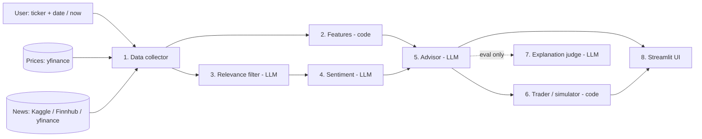

# Stock News Awareness Assistant — Report

Assignment 1, "Build an NLP System". Repository: https://github.com/Ruslan4040/stock-news-assistant

Every number in this report is filled in from a file in `evals/results/` by `python -m evals.render_docs`. Results date: 2026-11-15. Model: `google/gemma-4-31b-it:free`.

## 1. Task and scope

**Task.** Help a retail investor follow one company: show the price trend, the news that really concerns the company with a sentiment label, and one explained suggestion (buy / hold / sell, for 1 day or 1 week, with a confidence from 0 to 100). Then measure honestly whether the suggestions are any good, and whether the LLM only looks good on old data because it memorized what happened next.

**In scope.** 8 US large caps (GOOGL, NVDA, TSLA, JPM, INTC, NFLX, AVGO, HD); headlines only; daily prices; a historical mode and a live mode; a long-only trading simulator; an evaluation of every component; a look-ahead (memorization) experiment.

**Out of scope.** Real trading, intraday data, short selling, portfolio optimization, full article text, fine-tuning.

**Business rules kept in scope.**
- A decision at the close of day t uses prices up to t and headlines of the last 3 days. News published after the close, or without a time, belongs to the next trading day.
- The advisor may use only what is in its prompt and must list the headlines it relied on. With no relevant news it advises from price features only and says so (`news_used = false`).
- The LLM never calculates. Returns and volatility are computed in Python.
- Live mode: one advice per ticker per day, plus a new one when a new relevant headline appears.
- Simulator: $10,000, long only, buys when the advice is `buy` with confidence ≥ 70, 20% of equity per trade, holds for the advised horizon or until a later `sell`, fee 0.1% per trade.

## 2. Data

| Dataset | Source | Size used | Used for |
|---|---|---|---|
| Daily prices | Yahoo Finance (`yfinance`), 2018-01-02 → 2026-11-13 | 17,840 rows, 8 tickers | features, ground truth, simulator |
| Historical headlines | Kaggle "Daily Financial News for 6000+ Stocks" | 24,967 rows for our tickers, 9,202 in 2019 | sets A and B |
| Fresh headlines | Finnhub `company-news` (free key) | 18,351 items in 427 ticker-days, Nov 2025 → Nov 2026 | set C, live mode |
| Live headlines backup | `yfinance` `Ticker.news` | 10 items per ticker | live mode only |
| Sentiment exam | Financial PhraseBank, ≥ 75% annotator agreement | 3,453 sentences, sample of 400 | sentiment eval |
| Labeled fresh headlines | sampled from the Finnhub headlines | 100 headlines: relevant (y/n) + sentiment | relevance eval, fresh sentiment eval |

No synthetic data is used. Existing datasets were checked first and four were rejected: FNSPID (about 30 GB, too heavy), NIFTY (market level, not per company), EDT (event detection, a different task) and DLT-Sentiment-News (crypto only).

**What Data Understanding changed in the project.**
- AAPL, MSFT, AMZN and META have no 2019 headlines in the Kaggle files. They were replaced by INTC, NFLX, AVGO and HD so that sets A and C use the same tickers.
- No 2019 headline has a time of day, so every 2019 headline is assigned to the next trading day. This is the safe side for look-ahead.
- Most headlines tagged with a ticker are not about the company. On average only 4.120 of 10.040 headlines per 2019 decision even name it. This is why the relevance filter exists.
- 4.4% of the raw rows are duplicates (the same headline under GOOG and GOOGL, for example). They are removed.

**Evaluation sets.** A: 300 decisions (ticker, day) sampled from 2019 with seed 42. B: the same decisions with company names, people, products, dates and dollar amounts removed. C: 300 decisions from Nov 2025 – Nov 2026, after the model's knowledge cutoff (January 2025). The free API allowed 200 decisions per set to go through the LLM; they are the first ones of a fixed random order.

## 3. Components

| # | Component | Purpose | Calls | Input | Output |
|---|---|---|---|---|---|
| 1 | Data collector | give the pipeline only what was known at decision time | external APIs: yfinance, Finnhub; local files | ticker, date | prices up to t, up to 15 most recent headlines of [t − 3 days, t] |
| 2 | Features | turn prices into trend numbers, because LLMs are bad at arithmetic | code | prices | 1-, 5-, 20-day returns, 20-day volatility and its level |
| 3 | Relevance filter | drop headlines that are not about the company | LLM call 1 | company, aliases, headlines | per headline: relevant yes / no + reason |
| 4 | Sentiment labeler | say whether each relevant headline is good or bad for the stock | LLM call 2 | company, relevant headlines | per headline: positive / negative / neutral + reason |
| 5 | Advisor | combine trend and news into one explained, calibrated suggestion | LLM call 3 | features in percent, labeled headlines | action, horizon, confidence, explanation, ids of headlines used |
| 6 | Trader | measure whether confident advice makes money | code | advice stream, prices | trades, equity curve, metrics |
| 7 | Explanation judge | check that explanations do not invent facts | LLM call 4, evaluation only | explanation + the advisor's inputs | per claim: supported yes / no |
| 8 | UI | show everything and the trace of one request | Streamlit | user input | chart, headline table, advice card, trace panel, simulator tab, evals tab |

All four LLM calls go through one client (`src/llm/client.py`): OpenRouter, temperature 0, a disk cache keyed by model, prompt version and input, retries with backoff, a rate limiter, JSON validation with pydantic, one repair retry on invalid output, and a trace log. Prompts are versioned files in `prompts/`.

### Walkthrough of one input (real values)
Input: `NVDA`, `2019-05-15`, historical mode.

1. **Collector.** Loads prices up to 2019-05-15 and 8 headlines. The 2019 headlines have no time, so each one counts from the trading day after its date.
2. **Features (code).** 1-day return -1.520%, 5-day -8.250%, 20-day -15.210%, volatility 2.170% (high).
3. **Relevance (LLM call 1).** Keeps 3 of 8 headlines.
4. **Sentiment (LLM call 2).** 2 positive, 1 negative, 0 neutral.

| # | Published | Headline | Relevant | Sentiment |
|---|---|---|---|---|
| 1 | 2019-05-14 | Shares of several semiconductor and microchip companies are trading higher as US markets rebound on renewed optimism surrounding US-China trade talks. | no |  |
| 2 | 2019-05-14 | Stifel Nicolaus Maintains Hold on NVIDIA Corporation - Common Stock, Lowers Price Target to $145 | yes | negative |
| 3 | 2019-05-13 | Morgan Stanley Earlier Maintained Equal-Weight on NVIDIA Corporation - Common Stock, Raised Price Target to $170 | yes | positive |
| 4 | 2019-05-13 | Goldman Maintains Buy On Nvidia, Maintains $185 Target Ahead Of Co's Earnings 5/16 Post Close As Firm Remains Bullish Long-Term, But Expects 'Gaming to remain weak on channel adjustments while Datacenter likely to be impacted by near term customer pauses' | yes | positive |
| 5 | 2019-05-13 | Trade War Heats Up As China Retaliates With Raised Tariffs Of Its Own | no |  |
| 6 | 2019-05-13 | Shares of several technology companies are trading lower amid continued US-China trade concerns. Proposed tariffs between the two nations could raise input costs, while trade tensions could hurt tech companies with China exposure. | no |  |
| 7 | 2019-05-10 | Shares of several technology companies are trading lower on continued uncertainty surrounding the future of trade relations between the US and China after the Trump Administration increased tariffs on $200 million of Chinese goods from 10% to 25%. | no |  |
| 8 | 2019-05-10 | Tariff Troubles: Market Retreat Looks To Continue As U.S. Raises Levies On China Goods | no |  |

5. **Advisor (LLM call 3).** `sell`, horizon `1w`, confidence 65, headlines used: [2, 4].
   > The stock is in a strong downward trend, with returns of -8.25% over 5 days and -15.21% over 20 days. While Goldman Sachs maintains a Buy rating, they explicitly expect gaming to remain weak and datacenter to be impacted by near term customer pauses. Combined with a lowered price target from Stifel Nicolaus and high volatility, the short-term momentum remains negative.
6. **Trader.** action is sell, not buy → no trade.
7. **Judge (evaluation only).** 7 of 7 claims in the explanation are supported by the inputs.
8. **UI.** Shows the chart, the table above with tinted sentiment cells, the advice card and the trace of the LLM calls of this request.
9. **Ground truth.** The price moved 0.4% over the next day and -4.6% over the next week, so this advice counts as: **hit**.

## 4. How CRISP-DM was applied

The phases and their gates are written into `AGENTS.md`, so the coding agent had to name the phase at the start of every task and could not start a phase before the previous gate was met. Each phase has a log in `docs/crisp_dm/`.

| Phase | What was produced | Gate | Evidence |
|---|---|---|---|
| 1. Business Understanding | goal, users, scope, 13 success criteria with numeric targets, 9 risks | the human approves the document | `01_business.md` |
| 2. Data Understanding | download scripts, six data cards generated by code | a card for every dataset | `02_data.md` |
| 3. Data Preparation | cleaning, time alignment, sets A / B / C, outcomes kept apart from inputs | `pytest` passes, including no-look-ahead | `03_preparation.md` |
| 4. Modeling | LLM client, four LLM components, simulator, prompts v1 | a passing unit test per component | `04_modeling.md` |
| 5. Evaluation | one eval script per component, baselines, intervals, error files, the look-ahead experiment | a metric and a baseline per component | `05_evaluation.md` |
| 6. Deployment | Streamlit app with a trace panel, README, this report, demo script | the app runs from a clean clone; the UI checklist passes | `06_deployment.md` |

CRISP-DM is a cycle, and the project went back more than once. The loops are recorded in `docs/crisp_dm/iterations.md`.

| Loop | Trigger | Phase revisited | Change | Before → after |
|---|---|---|---|---|
| 1 | 4 of the 8 tickers had no 2019 headlines | 1. scope | the human replaced them with INTC, NFLX, AVGO, HD | tickers with 2019 news: 4 → 8 of 8 |
| 2 | "invalid JSON" in the first real run | 4. LLM client | an answer cut short by the provider counts as an API failure and is retried | invalid first answers: 3 of 8 → 0 of 371 |
| 3 | 6 of 40 pipeline runs incomplete after quota errors | 4. LLM client | the retry hint is kept; quota errors pause all threads and do not use up retries | incomplete: 6 of 40 → 0 of 80 |
| 4 | the advisor chose one week almost always | 4. advisor prompt | `advisor_v2` with a horizon rule | no gain; v2 rejected (§5.9) |

## 5. Evaluation

Every component has its own script `evals/eval_<component>.py`, a metric, a baseline, n and a 95% bootstrap confidence interval. The ten worst errors of each component are saved in `evals/results/<component>_errors.csv`. The full table is in `README.md`.

### 5.1 Targets from phase 1
The targets were written down before any evaluation was run. "Not measured" means that the bucket or file needed for the check has no data.

| Component | Target (set in phase 1) | Result | Met |
|---|---|---|---|
| Data collector | missing days, duplicates in sets, look-ahead violations: all 0 | 0.000 / 0.000 / 0.000 | yes |
| Features | exact match on 15 of 15 cases | 15 of 15 | yes |
| LLM client | valid JSON on the first answer ≥ 0.95; invalid after retry ≤ 0.02 | 0.998; 0.001 | yes |
| UI | all demo cases pass the checklist | 3 of 3 | yes |
| Relevance filter | F1 ≥ 0.80, precision ≥ 0.80, F1 above keep-all | F1 0.963, precision 0.951, keep-all F1 0.571 | yes |
| Sentiment (PhraseBank) | macro-F1 ≥ 0.80, above always-neutral, within 0.05 of FinBERT | 0.899 (FinBERT 0.927, always-neutral 0.253) | yes |
| Sentiment (fresh headlines) | macro-F1 ≥ 0.70 | 0.898 | yes |
| Explanations | claims supported ≥ 0.90; judge vs label agreement ≥ 0.80 | 0.998; 0.991 | yes |
| Advisor: direction (set C) | hit rate above always-buy and same-as-last-move | 0.527 vs 0.450 and 0.519 | yes |
| Advisor: horizon (set C) | mean return with the chosen horizon ≥ the better fixed one | 0.443% vs 0.408% | yes |
| Advisor: confidence (set C) | bucket 80–100 at least 5 points above bucket 50–60 | 0.667 vs 0.400 | yes |
| Trader (set C) | total return > 0 and max drawdown below buy & hold | return 0.025, drawdown 0.064 vs 0.292 | yes |
| Look-ahead experiment | a clear yes / no by the rule of spec §8 | the LLM peeks: False | yes |

**How to read "yes".** The targets were written as comparisons of point estimates, and every one of them is met on the point estimate. For the three advisor rows that is weaker than it looks:
- **Direction.** The baselines lie inside the advisor's 95% interval (§5.5).
- **Horizon.** The chosen horizon is one week in almost every case, so it nearly equals the fixed one-week baseline.
- **Confidence.** The outer confidence buckets hold only 5 and 9 decisions.

These rows are "met, but not shown to be better than chance". The data, feature, client, relevance, sentiment and judge targets are met with margin.

### 5.2 Deterministic parts: data, features, client, UI
| Component | Metric | Result | n |
|---|---|---|---|
| Data collector | missing trading days | 0.0% | 17,840 ticker-days |
| Data collector | duplicate headlines in the raw rows, removed in cleaning | 4.4% | 24,967 rows |
| Data collector | look-ahead violations in sets A and C | 0 | 7,478 headlines |
| Data collector | set-B headlines that still show a name, a year or a dollar amount | 0 | 3,013 headlines |
| Features | exact match with the independent reference (tolerance 1e-6) | 15 of 15 | 3 tickers × 5 dates |
| LLM client | valid JSON on the first answer | 99.8% [99.6%, 100.0%] | 1,694 answered calls |
| LLM client | still invalid after the repair retry | 0.1% | 1,698 calls |
| LLM client | calls lost to API failures after all retries | 0.2% | 1,698 calls |
| LLM client | HTTP attempts per answered call; seconds per call | 4.214; 140.369 | 1,698 calls |
| LLM client | cache hit rate over all logged calls | 64.6% | 4,793 calls |
| UI | checklist items passed on the demo cases | 21 of 21 | 3 cases |

**Analysis.**
- **Results are not distorted by the client.** Almost every answer is valid JSON on the first try. Calls still invalid after the repair retry: 1 of 1,698. Calls lost to the API are counted separately (0.2%), so they never look like model mistakes: an advisor run with a lost language step is marked incomplete, not wrong.
- **The free API is slow, not the model.** One answered call needs 4.214 HTTP attempts on average (500/503 errors and quota refusals). The mean time per call (140.369 s) is measured from the start of the call to a valid answer: it includes retries and the time the call waited behind 16 parallel threads for the 30-requests-a-minute quota.
- **The cache.** It makes every eval re-run on the same machine free and identical. It is local (`.cache/llm`, about 7 MB, not in the repository), so a fresh clone calls the API again; at temperature 0 the answers were identical across repeats in the phase-4 smoke runs.

### 5.3 Relevance filter
100 labeled fresh headlines, of which 40.0% are relevant.

| System | Precision | Recall | F1 |
|---|---|---|---|
| LLM filter (`relevance_v1`) | 0.951 [0.872, 1.000] | 0.975 [0.921, 1.000] | 0.963 [0.909, 1.000] |
| Baseline: keep all | 0.400 | 1.000 | 0.571 |
| Baseline: keyword (headline names the company) | 0.848 | 0.975 | 0.907 |

**Analysis.** The keep-all baseline shows why the filter exists: only 40.0% of the headlines that Finnhub tags with a ticker are about that company. The LLM filter lost 1 relevant headline: "Is a 100-Year Bond Worth Buying?" is tagged GOOGL, and the human reviewer marked it relevant because the 100-year bond in the news was issued by Alphabet. The headline itself does not name the company, so the model called it a "general finance topic"; the keyword baseline misses it too. Both false positives (2) are JPMorgan headlines in which the bank is the commentator, not the subject: "JPMorgan Flips Bullish on Bitcoin Over the Next Ten Years" and "JPMorgan drops blunt take on software stocks AI threat" (`evals/results/relevance_errors.csv`). They are borderline cases, and the keyword baseline makes the same mistake, because the name is in the headline. The keyword baseline is strong on fresh headlines because Finnhub headlines usually name the company they are about. The LLM is better on headlines that name the company only in passing: lists of stocks ("Zacks Investment Ideas feature highlights: JP Morgan, Home Depot, Lennar, …") and the CEO's personal remarks ("Elon Musk Fires Back At AOC …"). Keyword matching keeps them; the LLM drops them. Before the human review this headline was labeled not relevant, so the filter's single miss comes from that one changed label.

### 5.4 Sentiment labeler
| Data | Metric | LLM (`sentiment_v1`) | FinBERT | Always neutral |
|---|---|---|---|---|
| PhraseBank sample (n = 400) | accuracy | 0.892 [0.863, 0.920] | 0.940 | 0.610 |
| PhraseBank sample | macro-F1 | 0.899 [0.865, 0.927] | 0.927 | 0.253 |
| Fresh headlines (n = 100) | accuracy | 0.910 [0.850, 0.960] | 0.460 | 0.740 |
| Fresh headlines | macro-F1 | 0.898 [0.810, 0.960] | 0.333 | 0.283 |
| Fresh, relevant only (n = 40) | macro-F1 | 0.934 [0.852, 1.000] | 0.396 | 0.173 |

**Analysis.**
- **PhraseBank.** The LLM did not miss a single negative sentence. Almost all of its errors are neutral sentences that it called positive (confusion matrix in `evals/results/sentiment.json`), for example "The combined value of the orders is EUR 45mn." The model reads plain business facts (orders, launches, plans) as good news, while the PhraseBank annotators called them neutral.
- **FinBERT on PhraseBank.** FinBERT scores higher here, but `ProsusAI/finbert` was fine-tuned on Financial PhraseBank, so this test favours it.
- **Fresh headlines.** On real headlines from the fresh period FinBERT falls to a macro-F1 of 0.333, while the LLM keeps 0.898. This is the data the system actually sees.
- **Errors on fresh headlines.** They are again neutral headlines labeled positive, mostly lists and market wrap-ups ("5 Stocks to Buy if AI Investing Comes Back Into Style"). The relevance filter removes most of these before sentiment is used, which is why the score on relevant headlines alone is higher (0.934).

### 5.5 Advisor
Hit rate = the share of buy and sell advice where the price moved in the advised direction over the chosen horizon. Hold advice has no direction; its share is shown. Baselines are computed on the same rows.

| | Set A (2019) | Set B (2019, anonymized) | Set C (after cutoff) |
|---|---|---|---|
| Decisions with valid advice | 200 | 200 | 200 |
| Share with a direction (buy or sell) | 65.5% | 65.5% | 65.5% |
| **Hit rate** | 49.6% [40.5%, 58.0%] | 48.1% [39.7%, 56.5%] | 52.7% [43.5%, 61.1%] |
| Baseline: always buy | 66.4% | 67.2% | 45.0% |
| Baseline: same as last move | 42.0% | 42.8% | 51.9% |
| Mean return in the advised direction, chosen horizon | -0.030% | -0.079% | 0.443% |
| Same advice, fixed 1 day / fixed 1 week | -0.045% / -0.049% | -0.103% / -0.098% | 0.092% / 0.408% |
| Hit rate, confidence 50–60 (n) | 22.2% (9) | 16.7% (6) | 40.0% (5) |
| Hit rate, confidence 60–80 (n) | 51.3% (117) | 49.2% (122) | 52.1% (117) |
| Hit rate, confidence 80–100 (n) | 60.0% (5) | 66.7% (3) | 66.7% (9) |

**Analysis.**
- **Direction, set C.** On the unseen period the advisor's hit rate (52.7%) is above "always buy" (45.0%) and "same as last move" (51.9%). Both baselines lie inside its interval, so with n = 131 this is not proof that the advice beats them.
- **Direction, set A.** In 2019 the advisor is clearly worse than always buy. 2019 was a strongly rising year, so every sell call had to be right against the trend. Only 15.6% of the sell calls in set A were right, against 60.6% of the buy calls. In set C the sell calls were right 60.0% of the time. The advisor reacts to negative news in the same way in both periods; the market did not.
- **Horizon.** The advisor chose one week in 198 of 200 decisions in set A and 199 of 200 in set C. The chosen horizon is therefore almost the same as "fixed 1 week", and the horizon criterion says little. A prompt with an explicit horizon rule was tried and rejected (§5.9).
- **Confidence.** The hit rate rises from the lowest to the highest confidence bucket in all three sets, which is the expected direction. But the model gives a confidence between 60 and 80 to almost every answer (mean 63.82 on set C), so the outer buckets hold only a few decisions each, and their intervals are wide.
- **A versus B.** Real names and dates (A) and the anonymized copy (B) give almost the same actions and hit rates; see §5.8.

### 5.6 Explanations and the judge
The judge split 100 explanations into 547 factual claims. **99.8%** [99.4%, 100.0%] of the claims are supported by the advisor's inputs. On the 109 claims that also have a label, the judge agrees with the label in **99.1%** [97.2%, 100.0%] of cases (labels: {'human_reviewed': 109}).

**Analysis.**
- **The explanations stay close to their inputs.** They mostly repeat the price features and headlines they were given. The only claim the judge rejected is reasoning, not an invented fact: "Medium volatility suggests a one-week horizon for negative momentum" (`evals/results/judge_errors.csv`).
- **The agreement number proves less than it seems.** The labels mark almost every claim as supported, so a judge that always answers "supported" reaches the same agreement (99.1%). The one disagreement shows that the judge is lenient with paraphrase: it accepted "regulatory scrutiny" for a headline about a senator's scrutiny.
- **A test with known false claims.** To check whether the judge catches hallucinations at all, one false sentence was added to each of the 20 labeled explanations. Half of them got a wrong 20-day return (off by 6.5 points), the other half an invented "$10 billion share buyback". The judge rejected **100.0%** of the planted claims; a judge that accepts everything catches none of them. It catches plain invented facts and wrong numbers, but it is lenient with loose wording of true facts.

### 5.7 Trader (simulator)
| | Set A | Set B | Set C |
|---|---|---|---|
| Trades | 21 | 19 | 23 |
| Total return | -2.6% [-10.6%, 5.8%] | 1.0% [-6.3%, 9.1%] | 2.5% [-9.4%, 16.9%] |
| Buy & hold, same days | 38.8% | 38.8% | 0.8% |
| Sharpe (buy & hold) | -0.570 (1.711) | 0.263 (1.711) | 0.426 (0.186) |
| Max drawdown (buy & hold) | 7.1% (18.6%) | 3.9% (18.6%) | 6.4% (29.2%) |
| Winning trades | 42.9% | 47.4% | 56.5% |
| Mean share of equity invested | 8.0% | 7.2% | 9.5% |

**Analysis.** The trader buys only on buy advice with confidence of at least 70, so it trades rarely and keeps most of its money in cash: on average it had only 9.5% of its equity invested in set C. Buy & hold is always fully invested, so the two are not like for like.
- **Set A.** The gap to buy & hold in 2019 (-2.6% against 38.8%) comes mostly from sitting in cash during a rising year.
- **Set C.** In the flat fresh period the trader made 2.5% with a much smaller drawdown than buy & hold. This meets the phase-1 target, but the interval of the return includes zero, and the small drawdown is mostly a result of the small exposure.
- **What to change.** A fairer baseline would be buy & hold scaled to the same exposure. It is listed in §7 as further work.

### 5.8 Look-ahead experiment: does the LLM remember the future?
| Check | Result |
|---|---|
| Hit rate A (2019, real names) | 49.6% [40.5%, 58.0%], n = 131 |
| Hit rate B (same rows, anonymized) | 48.1% [39.7%, 56.5%], n = 131 |
| Hit rate C (after the knowledge cutoff) | 52.7% [43.5%, 61.1%], n = 131 |
| A minus B on the same decisions (paired) | 0.0% [0.0%, 0.0%], n = 124 |
| Memory probe: 2019 closing prices within ± 5% | 36.0% [24.0%, 50.0%], n = 50 |
| Memory probe: control dates after the cutoff | 0.0% [0.0%, 0.0%], n = 50 |
| Sentiment gap: PhraseBank accuracy minus fresh accuracy | -0.018 [-0.082, 0.045] |
| **Decision by the rule** (A.ci_low > C.ci_high and A.ci_low > B.ci_high (hit rate)) | **the LLM peeks: False** |

**Analysis.**
- **The model does remember 2019 prices, roughly.** Asked for a 2019 close from memory, it is within ± 5% in 36.0% of the questions (a hit counts against the price of that day either before or after later stock splits). For dates after its cutoff it declined to answer all 50 questions instead of guessing. So it knows the 2019 price level of these companies, and it knows what it does not know.
- **The advisor does not use that memory.**
  - Set A is not better than C: its hit rate is lower, and the intervals overlap.
  - On the same decisions, real names and dates (A) and the anonymized copy (B) gave the same action in 93.0% of the cases.
  - Wherever both gave a direction, it was the same direction, so the paired difference in hit rate is exactly 0.0%.
  - The advice is driven by the features and headlines in the prompt, not by the company's name or the date.
- **Sentiment gap.** PhraseBank accuracy is not higher than accuracy on the fresh headlines (difference -0.018, interval includes 0). This gives no sign that the model memorized the PhraseBank labels.
- **Decision.** By the rule fixed in the spec, **the LLM does not peek** in the advice task. The memory probe shows that a weaker design could leak: a prompt that asks "what happened next?" might get remembered answers. Our advisor gets only features and headlines, and it does not.

### 5.9 Improvement loop
The weakest point the evaluation found in the advisor was the horizon: `advisor_v1` almost never chose one day. `prompts/advisor_v2.md` adds an explicit rule for choosing the horizon and two short examples. It was compared with v1 on the first 50 decisions of sets A and C (`python -m evals.compare_advisor_prompts`).

| Set C, first 50 decisions | `advisor_v1` | `advisor_v2` |
|---|---|---|
| Share of 1-day horizons | 0.0% | 4.0% |
| Share with a direction | 52.0% | 84.0% |
| Hit rate (n) | 53.8% (26) | 50.0% (42) |
| Mean return, chosen horizon | 0.952% | -0.376% |
| Set A hit rate (n) | 61.3% (31) | 59.0% (39) |

v2 barely changed the horizon. It gave more buy and sell answers, and those extra answers were less accurate. All intervals overlap, so v2 is not proven worse either, but there was no evidence of a gain worth a full new run on the free quota. **v2 was rejected and v1 stays.** This loop is recorded as a negative result in `docs/crisp_dm/iterations.md` (loop 4). The other three loops changed the scope and the LLM client; they are summarized in §4.

## 6. Use of the AI coding assistant

The system was built with Claude Code. The agent was steered through files in the repository, not only through chat prompts.

| File | What it controls |
|---|---|
| `docs/PROJECT_SPEC.md` | WHAT to build: scope, data, components, business rules, metrics, the look-ahead experiment |
| `AGENTS.md` | HOW to build: CRISP-DM phases and gates, repository layout, coding conventions, LLM rules, data rules (no look-ahead), evaluation rules, how to work with the human, the definition of done |
| `CLAUDE.md` | loads both files into every session; requires plan mode for multi-file changes; one fresh session per phase |
| `.claude/skills/crisp-dm-phase` | how to write a phase log entry: what was done, decisions with the rejected alternative, evidence, gate status |
| `.claude/skills/add-component` | the fixed recipe for a component: plan, schema, prompt file, code, mocked test, eval script, docs |
| `.claude/skills/run-evals` | how to run all evals and refresh the results table |

**Context control.** The rules live in files that reload in every session, so nothing depends on chat history. The spec says what, `AGENTS.md` says how. The CRISP-DM logs carry the state from one phase to the next. Before any multi-file change the agent writes a plan and waits for approval; decisions that belong to the human are asked as explicit choices with a recommendation.

**Quality control that does not rely on the agent's good behavior.**
- `pytest` with the LLM always mocked (2026-11-15: all tests pass), and `ruff`.
- `tests/test_conventions.py` fails when a function is longer than 40 lines or has no docstring or return type.
- `tests/test_no_lookahead.py` fails when any decision of the real sets contains a headline from after its close.
- Numbers in the README and in this report are rendered from results files, so the agent cannot type a metric by hand.

**What went wrong or was unexpected, and what changed.**

| What happened | What changed | Result |
|---|---|---|
| The spec listed AAPL, MSFT, AMZN and META. The agent checked the data before coding and found no 2019 headlines for them. | The human chose replacement tickers; the spec and `config.yaml` were updated. | Sets A and C use the same 8 tickers. |
| The human proposed several OpenRouter accounts to get around the limit of 50 free requests a day. The agent read the terms and the limits page first: several accounts are forbidden and do not raise the limit. | A free Google AI Studio key was connected to OpenRouter instead. | The daily limit no longer applies; the limit became 30 requests a minute. |
| The first real run reported "invalid JSON" from the model. The raw answers showed that the provider had cut them short. | The client treats a cut answer as an API failure and retries it; a test covers it. | Invalid first answers: 3 of 8 before; afterwards 99.8% of 1,694 answers were valid on the first try (§5.2). |
| Quota errors used up the retries, because the client shortened error messages and lost the "retry in N seconds" hint. | The hint is kept; a quota error pauses all threads and is not counted as a retry. | Incomplete pipeline runs: 6 of 40 before, 0 after. |
| Building the news table took 170 seconds because the config file was parsed again for every row. | The config is cached. | 2.6 seconds. |
| Twice the agent wrote a test whose hand-computed expected value was wrong, while the code was right. | The agent re-derived the expected values by hand instead of changing the code to fit. | Tests now document the arithmetic in comments. |
| The free API gave about 8 answers a minute, with about 3 HTTP attempts per answer. | The run starts with `evals.batch_limit` = 200 decisions per set, the first 200 of a fixed random order. | More decisions can be added by raising the limit; earlier results stay the same. |
| To speed up the work, the human let the agent make the first labeling pass of the 100 fresh headlines and the judge claims. | The agent drafted the labels following written rules (`evals/labels/README.md`) and marked them `labeled_by = assistant_draft`. The human then reviewed both files, changed one relevance label, and `python -m evals.confirm_labels` switched them to `human_reviewed`. | Results files and this report say who labeled the data. |

**Lessons.**
- Rules in files work better than rules in chat. The gates, the "no look-ahead" rule and the "one place for LLM calls" rule were followed in every phase because they were reloaded each time.
- A rule the agent can break silently should become a test. Function length, docstrings and look-ahead are checked by `pytest`, and documents take their numbers from results files.
- Ask the agent to check the data and the limits before it plans. Two of the largest changes (the tickers and the API route) came from facts found before coding; the third (the sample size) came from measuring the API in an early smoke run.
- The human keeps the decisions: the model, the tickers and the API route were chosen by the human from options that the agent prepared with evidence. Where work was delegated (the labels), the files record it.

## 7. Limitations

- **Small samples.** 200 decisions per set give 131 directional calls on set C, so the interval of a hit rate is about ± 9 points. Differences smaller than that cannot be shown.
- **Label provenance.** The 100 fresh labels and the judge claims were drafted by the coding assistant and then reviewed by the human ({'human_reviewed': 100}); the review changed one label. The same assistant wrote the prompts, and a reviewer who starts from a draft tends to accept it, so agreement with the model may still be optimistic.
- **Different market periods.** 2019 was a rising market and the fresh period was not, so A and C differ in more than what the model can remember. The A versus B comparison (same rows) is the cleaner test.
- **News window.** Only the 15 most recent headlines are used. For a busy ticker such as NVDA they cover the last 1.4 hours before the close, not 3 days. A keyword pre-filter would widen the window.
- **Daily prices.** Trades execute at the close of the decision day, with no slippage. Undated 2019 news is pushed to the next day, which is safe but throws away same-day information.
- **Anonymization is best effort.** Set B hides names, people, products, dates and dollar amounts, but other companies in a headline remain and can hint at the sector.
- **A free model on a free API.** An answered call needs 4.214 HTTP attempts on average; the rest fail and are retried. The system works, but a live request can take a minute or more.
- **The judge test is narrow.** Almost all real claims are true, so agreement with the labels equals that of a judge that accepts everything. The planted claims show that it catches obvious inventions, but not whether it catches subtle ones, such as a wrong sentiment attributed to a true headline.
- **Trader baseline.** Buy & hold is fully invested while the trader is mostly in cash, so their returns are not like for like. A buy & hold scaled to the trader's exposure would be a fairer baseline and is a next step.

**Next steps.**
- **Score the live advice.** Live mode already saves every advice with its time, action, horizon and confidence (`data/processed/live/advice.jsonl`). After a few trading days these records can be scored the same way as set C, as a fully out-of-sample check.
- **More decisions per set.** Raise `evals.batch_limit` from 200 to 300 and re-run; the first 200 results stay the same.
- **Exposure-matched buy & hold** as the trader baseline.
