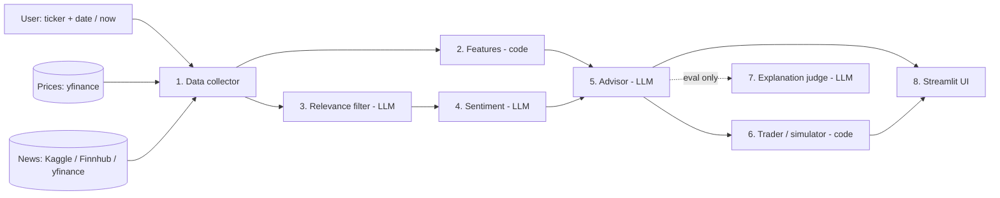

# Stock News Awareness Assistant — Report

Assignment 1, "Build an NLP System". Repository: https://github.com/Ruslan4040/stock-news-assistant

Every number in this report is filled in from a file in `evals/results/` by `python -m evals.render_docs`. Results date: {{advisor:#run_date}}. Model: `{{advisor:#model}}`.

## 1. Task and scope

**Task.** Help a retail investor follow one company: show the price trend, the news that really concerns the company with a sentiment label, and one explained suggestion (buy / hold / sell, for 1 day or 1 week, with a confidence from 0 to 100). Then measure honestly whether the suggestions are any good, and whether the LLM only looks good on old data because it memorized what happened next.

**In scope.** {{data:@tickers}} US large caps (GOOGL, NVDA, TSLA, JPM, INTC, NFLX, AVGO, HD); headlines only; daily prices; a historical mode and a live mode; a long-only trading simulator; an evaluation of every component; a look-ahead (memorization) experiment.

**Out of scope.** Real trading, intraday data, short selling, portfolio optimization, full article text, fine-tuning.

**Business rules kept in scope.**
- A decision at the close of day t uses prices up to t and headlines of the last 3 days. News published after the close, or without a time, belongs to the next trading day.
- The advisor may use only what is in its prompt and must list the headlines it relied on. With no relevant news it advises from price features only and says so (`news_used = false`).
- The LLM never calculates. Returns and volatility are computed in Python.
- Live mode: one advice per ticker per day, plus a new one when a new relevant headline appears.
- Simulator: $10,000, long only, buys when the advice is `buy` with confidence ≥ 70, 20% of equity per trade, holds for the advised horizon or until a later `sell`, fee 0.1% per trade.

## 2. Data

| Dataset | Source | Size used | Used for |
|---|---|---|---|
| Daily prices | Yahoo Finance (`yfinance`), 2018-01-02 → 2026-11-13 | {{data:missing_trading_days_rate:n|int}} rows, {{data:@tickers}} tickers | features, ground truth, simulator |
| Historical headlines | Kaggle "Daily Financial News for 6000+ Stocks" | {{data:@kaggle.rows_for_tickers|int}} rows for our tickers, {{data:@kaggle.rows_in_set_a_year|int}} in 2019 | sets A and B |
| Fresh headlines | Finnhub `company-news` (free key) | {{data:@finnhub.items|int}} items in {{data:@finnhub.day_files}} ticker-days, Nov 2025 → Nov 2026 | set C, live mode |
| Live headlines backup | `yfinance` `Ticker.news` | 10 items per ticker | live mode only |
| Sentiment exam | Financial PhraseBank, ≥ 75% annotator agreement | {{data:@phrasebank_sentences|int}} sentences, sample of {{sentiment:phrasebank.accuracy:n}} | sentiment eval |
| Labeled fresh headlines | sampled from the Finnhub headlines | {{relevance:f1:n}} headlines: relevant (y/n) + sentiment | relevance eval, fresh sentiment eval |

No synthetic data is used. Existing datasets were checked first and four were rejected: FNSPID (about 30 GB, too heavy), NIFTY (market level, not per company), EDT (event detection, a different task) and DLT-Sentiment-News (crypto only).

**What Data Understanding changed in the project.**
- AAPL, MSFT, AMZN and META have no 2019 headlines in the Kaggle files. They were replaced by INTC, NFLX, AVGO and HD so that sets A and C use the same tickers.
- No 2019 headline has a time of day, so every 2019 headline is assigned to the next trading day. This is the safe side for look-ahead.
- Most headlines tagged with a ticker are not about the company. On average only {{data:@prepare_report.set_a.headlines_naming_company_mean}} of {{data:@prepare_report.set_a.headlines_per_decision_mean}} headlines per 2019 decision even name it. This is why the relevance filter exists.
- {{data:duplicate_headlines_rate_raw|pct}} of the raw rows are duplicates (the same headline under GOOG and GOOGL, for example). They are removed.

**Evaluation sets.** A: {{data:@prepare_report.set_a.decisions}} decisions (ticker, day) sampled from 2019 with seed 42. B: the same decisions with company names, people, products, dates and dollar amounts removed. C: {{data:@prepare_report.set_c.decisions}} decisions from Nov 2025 – Nov 2026, after the model's knowledge cutoff (January 2025). D: live advice recorded on the day of the run. The free API allowed {{advisor:@A.decisions}} decisions per set to go through the LLM; they are the first ones of a fixed random order.

## 3. Components

| # | Component | Purpose | Calls | Input | Output |
|---|---|---|---|---|---|
| 1 | Data collector | give the pipeline only what was known at decision time | external APIs: yfinance, Finnhub; local files | ticker, date | prices up to t, up to 15 most recent headlines of [t − 3 days, t] |
| 2 | Features | turn prices into trend numbers, because LLMs are bad at arithmetic | code | prices | 1-, 5-, 20-day returns, 20-day volatility and its level |
| 3 | Relevance filter | drop headlines that are not about the company | LLM call 1 | company, aliases, headlines | per headline: relevant yes / no + reason |
| 4 | Sentiment labeler | say whether each relevant headline is good or bad for the stock | LLM call 2 | company, relevant headlines | per headline: positive / negative / neutral + reason |
| 5 | Advisor | combine trend and news into one explained, calibrated suggestion | LLM call 3 | features in percent, labeled headlines | action, horizon, confidence, explanation, ids of headlines used |
| 6 | Trader | measure whether confident advice makes money | code | advice stream, prices | trades, equity curve, metrics |
| 7 | Explanation judge | check that explanations do not invent facts | LLM call 4, evaluation only | explanation + the advisor's inputs | per claim: supported yes / no |
| 8 | UI | show everything and the trace of one request | Streamlit | user input | chart, headline table, advice card, trace panel, simulator tab, evals tab |

All four LLM calls go through one client (`src/llm/client.py`): OpenRouter, temperature 0, a disk cache keyed by model, prompt version and input, retries with backoff, a rate limiter, JSON validation with pydantic, one repair retry on invalid output, and a trace log. Prompts are versioned files in `prompts/`.

### Walkthrough of one input (real values)
Input: `{{walkthrough:@ticker}}`, `{{walkthrough:@date}}`, historical mode.

1. **Collector.** Loads prices up to {{walkthrough:@date}} and {{walkthrough:@headlines}} headlines. The 2019 headlines have no time, so each one counts from the trading day after its date.
2. **Features (code).** 1-day return {{walkthrough:@features.ret_1d_pct}}%, 5-day {{walkthrough:@features.ret_5d_pct}}%, 20-day {{walkthrough:@features.ret_20d_pct}}%, volatility {{walkthrough:@features.volatility_20d_pct}}% ({{walkthrough:@features.volatility_level}}).
3. **Relevance (LLM call 1).** Keeps {{walkthrough:@relevant}} of {{walkthrough:@headlines}} headlines.
4. **Sentiment (LLM call 2).** {{walkthrough:@sentiment_counts.positive}} positive, {{walkthrough:@sentiment_counts.negative}} negative, {{walkthrough:@sentiment_counts.neutral}} neutral.

{{walkthrough:@headline_table|raw}}

5. **Advisor (LLM call 3).** `{{walkthrough:@advice.action}}`, horizon `{{walkthrough:@advice.horizon}}`, confidence {{walkthrough:@advice.confidence}}, headlines used: {{walkthrough:@advice.used_headlines|raw}}.
   > {{walkthrough:@advice.explanation|raw}}
6. **Trader.** {{walkthrough:@trader|raw}}.
7. **Judge (evaluation only).** {{walkthrough:@judge_supported}} of {{walkthrough:@judge_claims}} claims in the explanation are supported by the inputs.
8. **UI.** Shows the chart, the table above with tinted sentiment cells, the advice card and the trace of the {{walkthrough:@advice.news_used|raw}}-news request ({{walkthrough:@llm_calls|raw}}).
9. **Ground truth.** The price moved {{walkthrough:@outcome.fwd_1d|pct}} over the next day and {{walkthrough:@outcome.fwd_1w|pct}} over the next week, so this advice counts as: **{{walkthrough:@outcome.verdict|raw}}**.

## 4. How CRISP-DM was applied

The phases and their gates are written into `AGENTS.md`, so the coding agent had to name the phase at the start of every task and could not start a phase before the previous gate was met. Each phase has a log in `docs/crisp_dm/`.

| Phase | What was produced | Gate | Evidence |
|---|---|---|---|
| 1. Business Understanding | goal, users, scope, 13 success criteria with numeric targets, 9 risks | the human approves the document | `01_business.md` |
| 2. Data Understanding | download scripts, six data cards generated by code | a card for every dataset | `02_data.md` |
| 3. Data Preparation | cleaning, time alignment, sets A / B / C, outcomes kept apart from inputs | `pytest` passes, including no-look-ahead | `03_preparation.md` |
| 4. Modeling | LLM client, four LLM components, simulator, prompts v1 | a passing unit test per component | `04_modeling.md` |
| 5. Evaluation | one eval script per component, baselines, intervals, error files, the look-ahead experiment | a metric and a baseline per component | `05_evaluation.md` |
| 6. Deployment | Streamlit app with a trace panel, README, this report, demo script | the app runs from a clean clone; the UI checklist passes | `06_deployment.md` |

CRISP-DM is a cycle, and the project went back more than once. The loops are recorded in `docs/crisp_dm/iterations.md`.

ITERATIONS_SUMMARY

## 5. Evaluation

Every component has its own script `evals/eval_<component>.py`, a metric, a baseline, n and a 95% bootstrap confidence interval. The ten worst errors of each component are saved in `evals/results/<component>_errors.csv`. The full table is in `README.md`.

EVALUATION_SECTION

## 6. Use of the AI coding assistant

The system was built with Claude Code. The agent was steered through files in the repository, not only through chat prompts.

| File | What it controls |
|---|---|
| `docs/PROJECT_SPEC.md` | WHAT to build: scope, data, components, business rules, metrics, the look-ahead experiment |
| `AGENTS.md` | HOW to build: CRISP-DM phases and gates, repository layout, coding conventions, LLM rules, data rules (no look-ahead), evaluation rules, how to work with the human, the definition of done |
| `CLAUDE.md` | loads both files into every session; requires plan mode for multi-file changes; one fresh session per phase |
| `.claude/skills/crisp-dm-phase` | how to write a phase log entry: what was done, decisions with the rejected alternative, evidence, gate status |
| `.claude/skills/add-component` | the fixed recipe for a component: plan, schema, prompt file, code, mocked test, eval script, docs |
| `.claude/skills/run-evals` | how to run all evals and refresh the results table |

**Context control.** The rules live in files that reload in every session, so nothing depends on chat history. The spec says what, `AGENTS.md` says how. The CRISP-DM logs carry the state from one phase to the next. Before any multi-file change the agent writes a plan and waits for approval; decisions that belong to the human are asked as explicit choices with a recommendation.

**Quality control that does not rely on the agent's good behavior.**
- `pytest` with the LLM always mocked ({{ui:#run_date}}: all tests pass), and `ruff`.
- `tests/test_conventions.py` fails when a function is longer than 40 lines or has no docstring or return type.
- `tests/test_no_lookahead.py` fails when any decision of the real sets contains a headline from after its close.
- Numbers in the README and in this report are rendered from results files, so the agent cannot type a metric by hand.

**What went wrong or was unexpected, and what changed.**

AGENT_LESSONS

## 7. Limitations

LIMITATIONS_SECTION
